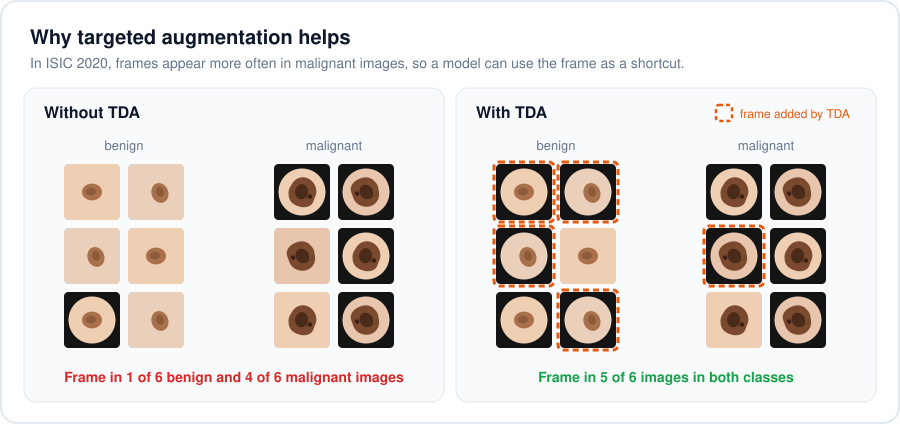
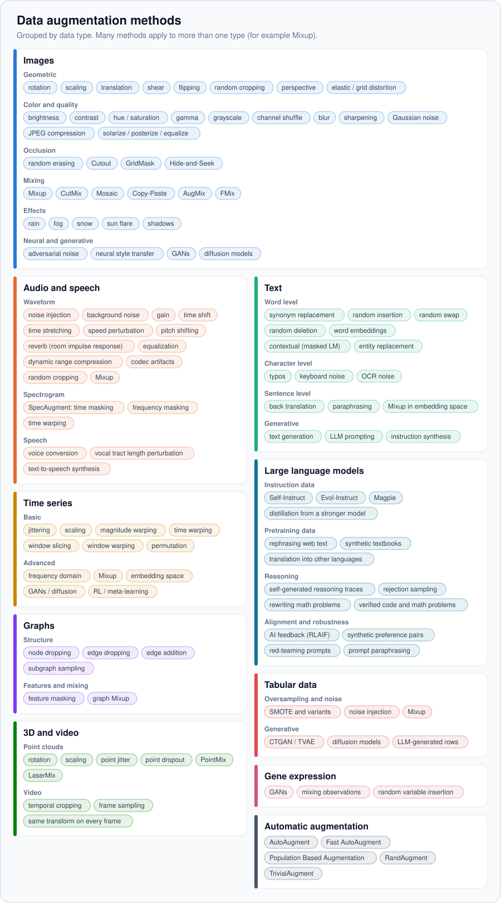
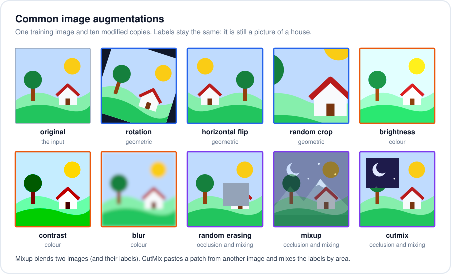
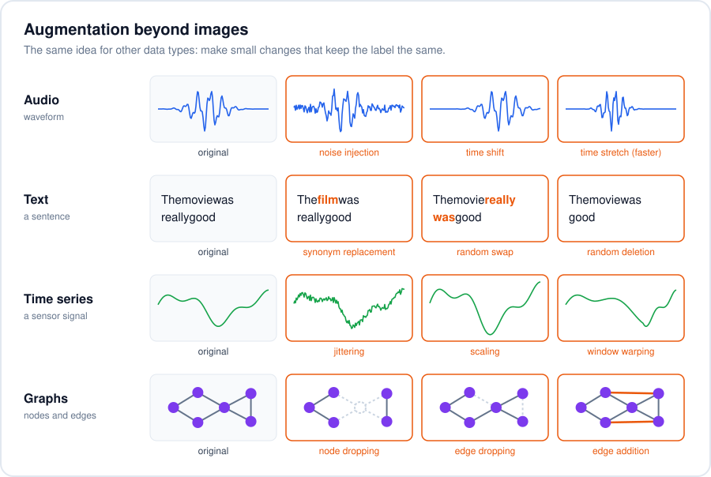
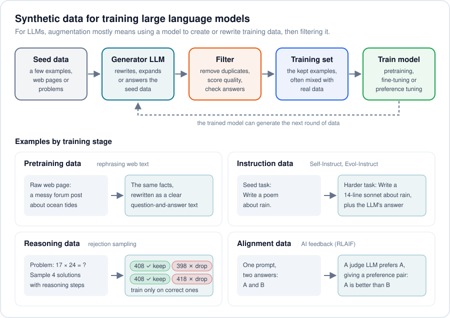
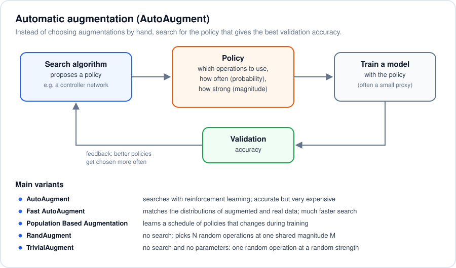

  

Looking for a person who would like to help me maintain this repository! Contact me on [LN](https://www.linkedin.com/in/agnieszkamikolajczyk/) or simply add a PR!

> **November 2026 update:** an extended overview of augmentation methods (now including large language models, tabular data, 3D and video), new illustrations, archived repositories marked as *(archived)*, broken links fixed, and new libraries and papers from 2023–2026, including new sections for graph augmentation and for generative and diffusion-based augmentation.

# Data augmentation
List of useful data augmentation resources. You will find here some links to more or less popular github repos :sparkles:, libraries, papers :books: and other information.

Do you like it? Feel free to :star: !
Feel free to make a pull request!

* [Introduction](README.md#Introduction)
* [Repositories](README.md#Repositories)
	* [Computer vision](README.md#Computer-vision)
	* [Natural Language Processing](README.md#Natural-Language-Processing)
	* [Large Language Models](README.md#large-language-models)
	* [Audio/Speech](README.md#Audio)
	* [Time series](README.md#Time-series)
	* [Graph Augmentation](README.md#Graph-Augmentation)
	* [Generative and diffusion-based](README.md#generative-and-diffusion-based-augmentation)
	* [AutoAugment](README.md#AutoAugment)
* [Papers](papers.md)
	* [2026](papers.md#2026)
	* [2025](papers.md#2025)
	* [2024](papers.md#2024)
	* [2023](papers.md#2023)
	* [2022](papers.md#2022)
	* [2021](papers.md#2021)
	* [2020](papers.md#2020)
	* [2019](papers.md#2019)
	* [2018](papers.md#2018)
	* [2017](papers.md#2017)
	* [2015](papers.md#2015)
	* [AutoAugment](papers.md#autoaugment)
* [Other - challenges, workshops, tutorials, books](README.md#Other)

# Featured ⭐
Data augmentation for bias mitigation?
* [Targeted Data Augmentation for bias mitigation](https://arxiv.org/abs/2308.11386); Agnieszka Mikołajczyk-Bareła, Maria Ferlin, Michał Grochowski; The development of fair and ethical AI systems requires careful consideration of bias mitigation, an area often overlooked or ignored. In this study, we introduce a novel and efficient approach for addressing biases called Targeted Data Augmentation (TDA), which leverages classical data augmentation techniques to tackle the pressing issue of bias in data and models. Unlike the laborious task of removing biases, our method proposes to insert biases instead, resulting in improved performance. (...) Code: [AgaMiko/targeted-data-augmentations](https://github.com/AgaMiko/targeted-data-augmentations)

# Introduction
Data augmentation can be simply described as any method that makes our dataset larger by making modified copies of the existing dataset. To create more images for example, we could zoom in and save the result, we could change the brightness of the image or rotate it. To get a bigger sound dataset we could try to raise or lower the pitch of the audio sample or slow down/speed up.
Example data augmentation techniques are presented in the diagram below.

What some of these transformations look like on an image:

The same idea works for other kinds of data:

## DATA AUGMENTATION
* ### Images augmentation
	* Geometric transformations
		* Rotation, scaling, translation, shear
		* Flipping (reflection)
		* Random cropping
		* Perspective transformation
		* Elastic and grid distortion
	* Color and quality transformations
		* Brightness and contrast shift
		* Hue and saturation shift, gamma
		* Grayscale, channel shuffle
		* Blurring, sharpening
		* Gaussian noise, JPEG compression
		* Solarize, posterize, equalize
	* Occlusion
		* Random erasing, Cutout
		* GridMask, Hide-and-Seek
	* Mixing images
		* Mixup, CutMix, FMix
		* Mosaic, Copy-Paste
		* AugMix
	* Effects
		* Adding rain, fog, snow, sun flare, shadows
	* Neural-based and generative transformations
		* Adversarial noise
		* Neural Style Transfer
		* Generative Adversarial Networks
		* Diffusion models (text-to-image generation, image editing)
* ### Audio augmentation
	* Waveform
		* Noise injection, background noise
		* Gain, equalization, dynamic range compression
		* Time shift, time stretching, speed perturbation
		* Pitch scaling
		* Reverb (room impulse responses)
		* Codec and compression artifacts
		* Random cropping, Mixup
	* Spectrogram
		* SpecAugment: time masking, frequency masking, time warping
	* Speech
		* Voice conversion
		* Vocal tract length perturbation
		* Text-to-speech synthesis
* ### Natural Language Processing augmentation
	* Word level
		* Thesaurus (synonym replacement)
		* Random insertion, swap, deletion
		* Word embeddings
		* Contextualized word embeddings (masked language models)
		* Entity replacement
	* Character level
		* Typos, keyboard and OCR noise
	* Sentence level
		* Back translation
		* Paraphrasing
		* Mixup in embedding space
	* Generative
		* Text generation
		* Prompting large language models
* ### Large Language Models (synthetic data)
	* Instruction data: Self-Instruct, Evol-Instruct, Magpie, distillation from a stronger model
	* Pretraining data: rephrasing web text, synthetic textbooks, translation into other languages
	* Reasoning data: self-generated reasoning traces, rejection sampling, rewriting math problems, problems checked by running code or verifying answers
	* Alignment and robustness: AI feedback (RLAIF), synthetic preference pairs, red-teaming prompts, prompt paraphrasing
* ### Time Series Data Augmentation
	* Basic approaches
		* Jittering
		* Scaling, magnitude warping
		* Time warping, window warping
		* Window slicing, cropping
		* Permutation
	* Advanced approaches
		* Frequency domain transformations
		* Mixup
		* Embedding space
		* GANs and diffusion models
		* RL/Meta-Learning
* ### Graph Augmentation
	* Node/edge dropping
	* Node/edge addition (graph modification)
	* Edge perturbation
	* Subgraph sampling
	* Feature masking
	* Graph Mixup
* ### Tabular data augmentation
	* SMOTE and its variants (oversampling)
	* Noise injection, Mixup
	* Generative models: CTGAN, TVAE, diffusion models
	* Rows generated by large language models
* ### 3D and video augmentation
	* Point clouds: rotation, scaling, point jitter, point dropout, PointMix, LaserMix
	* Video: temporal cropping, frame sampling, the same spatial transform applied to every frame
* ### Gene expression Augmentation
	* Data generation with GANs
	* Mixing observations
	* Random variable insertion
* ### Automatic Augmentation (AutoAugment)
	* AutoAugment, Fast AutoAugment, Population Based Augmentation
	* RandAugment, TrivialAugment (no search)
* Other
	* Keypoints/landmarks Augmentation - usually done with image augmentation (rotation, reflection) or graph augmentation methods (node/edge dropping)
	* Spectrograms/Melspectrograms -  usually done with time series data augmentation (jittering, perturbing, warping) or image augmentation (random erasing)

If you wish to cite us, you can cite the following paper of your choice:  [Style transfer-based image synthesis as an efficient regularization technique in deep learning](https://ieeexplore.ieee.org/document/8864616) or [Data augmentation for improving deep learning in image classification problem](https://ieeexplore.ieee.org/document/8388338).

# Repositories

## Computer vision

#### - [albumentations](https://github.com/albumentations-team/albumentations)  *(archived)* is a Python library with a set of useful, large, and diverse data augmentation methods. It offers over 30 different types of augmentations, easy and ready to use. Moreover, as the authors prove, the library is faster than other libraries on most of the transformations. 

The original repository was archived in July 2025. Development continues in [AlbumentationsX](https://github.com/albumentations-team/AlbumentationsX), which is licensed under AGPL-3.0 or a commercial license.

Example Jupyter notebooks:
* [All in one showcase notebook](https://github.com/albumentations-team/albumentations_examples/blob/main/notebooks/showcase.ipynb)
* [Classification](https://github.com/albumentations-team/albumentations_examples/blob/main/notebooks/example.ipynb),
* [Object detection](https://github.com/albumentations-team/albumentations_examples/blob/main/notebooks/example_bboxes.ipynb),  [image segmentation](https://github.com/albumentations-team/albumentations_examples/blob/main/notebooks/example_kaggle_salt.ipynb) and  [keypoints](https://github.com/albumentations-team/albumentations_examples/blob/main/notebooks/example_keypoints.ipynb)
* Others - [Weather transforms ](https://github.com/albumentations-team/albumentations_examples/blob/main/notebooks/example_weather_transforms.ipynb),
 [Serialization](https://github.com/albumentations-team/albumentations_examples/blob/main/notebooks/serialization.ipynb),
 [Replay/Deterministic mode](https://github.com/albumentations-team/albumentations_examples/blob/main/notebooks/replay.ipynb),  [Non-8-bit images](https://github.com/albumentations-team/albumentations_examples)

Example transformations:

#### - [imgaug](https://github.com/aleju/imgaug)  - is another very useful and widely used Python library. As the author describes: *it helps you with augmenting images for your machine learning projects. It converts a set of input images into a new, much larger set of slightly altered images.* It offers many augmentation techniques such as affine transformations, perspective transformations, contrast changes, gaussian noise, dropout of regions, hue/saturation changes, cropping/padding, and blurring.

Example Jupyter notebooks:
* [Load and Augment an Image](https://nbviewer.jupyter.org/github/aleju/imgaug-doc/blob/master/notebooks/A01%20-%20Load%20and%20Augment%20an%20Image.ipynb)
* [Multicore Augmentation](https://nbviewer.jupyter.org/github/aleju/imgaug-doc/blob/master/notebooks/A03%20-%20Multicore%20Augmentation.ipynb)
 * Augment and work with: [Keypoints/Landmarks](https://nbviewer.jupyter.org/github/aleju/imgaug-doc/blob/master/notebooks/B01%20-%20Augment%20Keypoints.ipynb),
    [Bounding Boxes](https://nbviewer.jupyter.org/github/aleju/imgaug-doc/blob/master/notebooks/B02%20-%20Augment%20Bounding%20Boxes.ipynb),
    [Polygons](https://nbviewer.jupyter.org/github/aleju/imgaug-doc/blob/master/notebooks/B03%20-%20Augment%20Polygons.ipynb),
    [Line Strings](https://nbviewer.jupyter.org/github/aleju/imgaug-doc/blob/master/notebooks/B06%20-%20Augment%20Line%20Strings.ipynb),
    [Heatmaps](https://nbviewer.jupyter.org/github/aleju/imgaug-doc/blob/master/notebooks/B04%20-%20Augment%20Heatmaps.ipynb),
    [Segmentation Maps](https://nbviewer.jupyter.org/github/aleju/imgaug-doc/blob/master/notebooks/B05%20-%20Augment%20Segmentation%20Maps.ipynb) 

Example transformations:

#### - [Kornia](https://github.com/kornia/kornia)  - is a differentiable computer vision library for PyTorch. It consists of a set of routines and differentiable modules to solve generic computer vision problems. At its core, the package uses PyTorch as its main backend both for efficiency and to take advantage of the reverse-mode auto-differentiation to define and compute the gradient of complex functions.

At a granular level, Kornia is a library that consists of the following components:

| **Component**                                                                    | **Description**                                                                                                                       |
|----------------------------------------------------------------------------------|---------------------------------------------------------------------------------------------------------------------------------------|
| [kornia](https://kornia.readthedocs.io/en/latest/index.html)                     | a Differentiable Computer Vision library, with strong GPU support                                                                     |
| [kornia.augmentation](https://kornia.readthedocs.io/en/latest/augmentation.html) | a module to perform data augmentation in the GPU                                                                                      |
| [kornia.color](https://kornia.readthedocs.io/en/latest/color.html)               | a set of routines to perform color space conversions                                                                                  |
| [kornia.contrib](https://kornia.readthedocs.io/en/latest/contrib.html)           | a compilation of user contributed and experimental operators                                                                              |
| [kornia.enhance](https://kornia.readthedocs.io/en/latest/enhance.html)           | a module to perform normalization and intensity transformation                                                                        |
| [kornia.feature](https://kornia.readthedocs.io/en/latest/feature.html)           | a module to perform feature detection                                                                                                 |
| [kornia.filters](https://kornia.readthedocs.io/en/latest/filters.html)           | a module to perform image filtering and edge detection                                                                                |
| [kornia.geometry](https://kornia.readthedocs.io/en/latest/geometry.html)         | a geometric computer vision library to perform image transformations, 3D linear algebra and conversions using different camera models |
| [kornia.losses](https://kornia.readthedocs.io/en/latest/losses.html)             | a stack of loss functions to solve different vision tasks                                                                             |
| [kornia.morphology](https://kornia.readthedocs.io/en/latest/morphology.html)     | a module to perform morphological operations                                                                                          |
| [kornia.utils](https://kornia.readthedocs.io/en/latest/)               | image to tensor utilities and metrics for vision problems                                                                             |

#### - [Data augmentation for object detection](https://github.com/Paperspace/DataAugmentationForObjectDetection)  - Repository contains a code for the paper [space tutorial series on adapting data augmentation methods for object detection tasks](https://blog.paperspace.com/data-augmentation-for-bounding-boxes/). They support a lot of data augmentations, like Horizontal Flipping, Scaling, Translation, Rotation, Shearing, Resizing.

#### - [FMix - Understanding and Enhancing Mixed Sample Data Augmentation](https://github.com/ecs-vlc/FMix)  This repository contains the official implementation of the paper ['Understanding and Enhancing Mixed Sample Data Augmentation'](https://arxiv.org/abs/2002.12047)

#### - [Super-AND](https://github.com/super-AND/super-AND)  - This repository is the Pytorch implementation of "A Comprehensive Approach to Unsupervised Embedding Learning based on AND Algorithm. 

#### - [vidaug](https://github.com/okankop/vidaug)  - This Python library helps you with augmenting videos for your deep learning architectures. It converts input videos into a new, much larger set of slightly altered videos.

#### - [Image augmentor](https://github.com/codebox/image_augmentor)  - This is a simple Python data augmentation tool for image files, intended for use with machine learning data sets. The tool scans a directory containing image files, and generates new images by performing a specified set of augmentation operations on each file that it finds. This process multiplies the number of training examples that can be used when developing a neural network, and should significantly improve the resulting network's performance, particularly when the number of training examples is relatively small.

#### - [Random erasing](https://github.com/zhunzhong07/Random-Erasing)  - The code is based on the paper: https://arxiv.org/abs/1708.04896. The Abstract:

In this paper, we introduce Random Erasing, a new data augmentation method for training the convolutional neural network (CNN). In training, Random Erasing randomly selects a rectangle region in an image and erases its pixels with random values. In this process, training images with various levels of occlusion are generated, which reduces the risk of over-fitting and makes the model robust to occlusion. Random Erasing is parameter learning free, easy to implement, and can be integrated with most of the CNN-based recognition models. Albeit simple, Random Erasing is complementary to commonly used data augmentation techniques such as random cropping and flipping, and yields consistent improvement over strong baselines in image classification, object detection and person re-identification. Code is available at: this https URL.

#### - [data augmentation in C++](https://github.com/takmin/DataAugmentation) -  Simple image augmentation program transform input images with rotation, slide, blur, and noise to create training data of image recognition.

#### - [Data augmentation with GANs](https://github.com/AntreasAntoniou/DAGAN)  - This repository contains files with Generative Adversarial Network, which can be used to successfully augment the dataset. This is an implementation of DAGAN as described in https://arxiv.org/abs/1711.04340. The implementation provides data loaders, model builders, model trainers, and synthetic data generators for the Omniglot and VGG-Face datasets.

#### - [Joint Discriminative and Generative Learning](https://github.com/NVlabs/DG-Net)  - This repo is for Joint Discriminative and Generative Learning for Person Re-identification (CVPR2019 Oral). The author proposes an end-to-end training network that simultaneously generates more training samples and conducts representation learning. Given N real samples, the network could generate O(NxN) high-fidelity samples.

[[Project]](http://zdzheng.xyz/DG-Net/) [[Paper]](https://arxiv.org/abs/1904.07223) [[YouTube]](https://www.youtube.com/watch?v=ubCrEAIpQs4) [[Bilibili]](https://www.bilibili.com/video/av51439240)
[[Supp]](http://jankautz.com/publications/JointReID_CVPR19_supp.pdf)

#### - [White-Balance Emulator for Color Augmentation](https://github.com/mahmoudnafifi/WB_color_augmenter)  - Our augmentation method can accurately emulate realistic color constancy degradation. Existing color augmentation methods often generate unrealistic colors which rarely happen in reality (e.g., green skin or purple grass). More importantly, the visual appearance of existing color augmentation techniques does not well represent the color casts produced by incorrect WB applied onboard cameras, as shown below. [python] [matlab]

#### - [DocCreator (OCR)](https://github.com/DocCreator/DocCreator)  - is an open source, cross-platform software allowing to generate synthetic document images and the accompanying ground truth. Various degradation models can be applied on original document images to create virtually unlimited amounts of different images.
A multi-platform and open-source software able to create synthetic image documents with ground truth.

#### - [OnlineAugment](https://github.com/zhiqiangdon/online-augment)  - implementation in PyTorch
- More automatic than AutoAugment and related 
  - Towards fully automatic (STN and VAE, No need to specify the image primitives). 
  - Broad domains (natural, medical images, etc). 
  - Diverse tasks (classification, segmentation, etc). 
- Easy to use 
  - One-stage training (user-friendly). 
  - Simple code (single GPU training, no need for parallel optimization). 
- Orthogonal to AutoAugment and related 
  - Online v.s. Offline (Joint optimization, no expensive offline policy searching). 
  - State-of-the-art performance (in combination with AutoAugment). 

#### - [Augraphy (OCR)](https://github.com/sparkfish/augraphy)  - is a Python library that creates multiple copies of original documents through an augmentation pipeline that randomly distorts each copy -- degrading the clean version into dirty and realistic copies rendered through synthetic paper printing, faxing, scanning and copy machine processes.

#### - [Data Augmentation optimized for GAN (DAG)](https://github.com/sutd-visual-computing-group/dag-gans)  - implementation in PyTorch and Tensorflow
DAG-GAN provides simple implementations of the DAG modules in both PyTorch and TensorFlow, which can be easily integrated into any GAN models to improve the performance, especially in the case of limited data. We only illustrate some augmentation techniques (rotation, cropping, flipping, ...) as discussed in our paper, but our DAG is not limited to these augmentations. The more augmentation to be used, the better improvements DAG enhances the GAN models. It is also easy to design your augmentations within the modules. However, there may be a trade-off between the numbers of many augmentations to be used in DAG and the computational cost.

#### - [Unsupervised Data Augmentation (google-research/uda)](https://github.com/google-research/uda)  *(archived)* - implementation in Tensorflow.
Unsupervised Data Augmentation or UDA is a semi-supervised learning method which achieves state-of-the-art results on a wide variety of language and vision tasks. With only 20 labeled examples, UDA outperforms the previous state-of-the-art on IMDb trained on 25,000 labeled examples.

They are releasing the following:
* Code for text classifications based on BERT.
* Code for image classifications on CIFAR-10 and SVHN.
* Code and checkpoints for our back translation augmentation system.

#### - [AugLy](https://github.com/facebookresearch/AugLy)   - AugLy is a data augmentations library that currently supports four modalities (audio, image, text & video) and over 100 augmentations. 

Each modality’s augmentations are contained within its own sub-library. These sub-libraries include both function-based and class-based transforms, composition operators, and have the option to provide metadata about the transform applied, including its intensity.

AugLy is a great library to utilize for augmenting your data in model training, or to evaluate the robustness gaps of your model! We designed AugLy to include many specific data augmentations that users perform in real life on internet platforms like Facebook's -- for example making an image into a meme, overlaying text/emojis on images/videos, reposting a screenshot from social media. While AugLy contains more generic data augmentations as well, it will be particularly useful to you if you're working on a problem like copy detection, hate speech detection, or copyright infringement where these "internet user" types of data augmentations are prevalent.

#### - [Data-Efficient GANs with DiffAugment](https://github.com/mit-han-lab/data-efficient-gans/)   - contains implementation of Differentiable Augmentation (DiffAugment) in both PyTorch and TensorFlow.
It can be used to significantly improve the data efficiency for GAN training. We have provided DiffAugment-stylegan2 (TensorFlow) and DiffAugment-stylegan2-pytorch, DiffAugment-biggan-cifar (PyTorch) for GPU training, and DiffAugment-biggan-imagenet (TensorFlow) for TPU training.

[project](https://hanlab.mit.edu/projects/diffaug) | [paper](https://arxiv.org/pdf/2006.10738) | [video](https://www.youtube.com/watch?v=SsqcjS6SVM0)

#### - [torchvision.transforms.v2](https://github.com/pytorch/vision)  - The current PyTorch transforms API ([docs](https://docs.pytorch.org/vision/stable/transforms.html)). It transforms images together with bounding boxes, masks, keypoints and videos, and includes AutoAugment, RandAugment, TrivialAugmentWide, AugMix, CutMix and MixUp.

#### - [timm (PyTorch Image Models)](https://github.com/huggingface/pytorch-image-models)  - Image model library with widely used implementations of AutoAugment, RandAugment, AugMix (with JSD loss), Mixup/CutMix and Random Erasing.

#### - [AugMix](https://github.com/google-research/augmix)  - Official code for AugMix. It mixes several randomly augmented copies of an image and adds a consistency loss to improve robustness and calibration.

#### - [TorchIO](https://github.com/TorchIO-project/torchio)  - Loading, preprocessing and augmentation of 3D medical images in PyTorch, including MRI-specific artifacts such as motion, ghosting, bias field and spikes.

#### - [MONAI](https://github.com/Project-MONAI/MONAI)  - PyTorch framework for medical imaging with a large set of 2D/3D dictionary-based transforms for images and their labels.

#### - [batchgenerators](https://github.com/MIC-DKFZ/batchgenerators)  - 2D and 3D data augmentation for medical image segmentation from DKFZ, used in nnU-Net.

#### - [LaserMix](https://github.com/worldbench/LaserMix)  - Mixes LiDAR scans by laser beam ranges for semi-supervised LiDAR semantic segmentation (CVPR 2023).

#### - [bnnr](https://github.com/bnnr-team/bnnr)  - PyTorch toolkit for saliency-guided augmentation. It uses the model's own saliency maps to decide where to mask the image: ICD (Intelligent Coarse Dropout) masks the regions the model already focuses on, and Anti-ICD masks low-saliency background. A branch search keeps only the augmentations that improve validation accuracy. [Paper](https://doi.org/10.5281/zenodo.20581077)

## Natural Language Processing

#### - [nlpaug](https://github.com/makcedward/nlpaug)   - This Python library helps you with augmenting nlp for your machine learning projects. Visit this introduction to understand about [Data Augmentation in NLP](https://towardsdatascience.com/data-augmentation-in-nlp-2801a34dfc28). `Augmenter` is the basic element of augmentation while `Flow` is a pipeline to orchestra multi augmenter together.

Features:
 *   Generate synthetic data for improving model performance without manual effort
 *   Simple, easy-to-use and lightweight library. Augment data in 3 lines of code
 *   Plug and play to any neural network frameworks (e.g. PyTorch, TensorFlow)
 *   Support textual and audio input

#### - [AugLy](https://github.com/facebookresearch/AugLy)   - AugLy is a data augmentations library that currently supports four modalities (audio, image, text & video) and over 100 augmentations. 

Each modality’s augmentations are contained within its own sub-library. These sub-libraries include both function-based and class-based transforms, composition operators, and have the option to provide metadata about the transform applied, including its intensity.

AugLy is a great library to utilize for augmenting your data in model training, or to evaluate the robustness gaps of your model! We designed AugLy to include many specific data augmentations that users perform in real life on internet platforms like Facebook's -- for example making an image into a meme, overlaying text/emojis on images/videos, reposting a screenshot from social media. While AugLy contains more generic data augmentations as well, it will be particularly useful to you if you're working on a problem like copy detection, hate speech detection, or copyright infringement where these "internet user" types of data augmentations are prevalent.

#### - [TextAttack 🐙](https://github.com/QData/TextAttack)   - TextAttack is a Python framework for adversarial attacks, data augmentation, and model training in NLP.
Many of the components of TextAttack are useful for data augmentation. The `textattack.Augmenter` class
uses a transformation and a list of constraints to augment data. We also offer five built-in recipes
for data augmentation [source:QData/TextAttack](https://github.com/QData/TextAttack):
- `textattack.WordNetAugmenter` augments text by replacing words with WordNet synonyms
- `textattack.EmbeddingAugmenter` augments text by replacing words with neighbors in the counter-fitted embedding space, with a constraint to ensure their cosine similarity is at least 0.8
- `textattack.CharSwapAugmenter` augments text by substituting, deleting, inserting, and swapping adjacent characters
- `textattack.EasyDataAugmenter` augments text with a combination of word insertions, substitutions and deletions.
- `textattack.CheckListAugmenter` augments text by contraction/extension and by substituting names, locations, numbers.
- `textattack.CLAREAugmenter` augments text by replacing, inserting, and merging with a pre-trained masked language model.

#### - [EDA NLP](https://github.com/jasonwei20/eda_nlp)   - **EDA** is an **e**asy **d**ata **a**ugmentation techniques for boosting performance on text classification tasks. These are a generalized set of data augmentation techniques that are easy to implement and have shown improvements on five NLP classification tasks, with substantial improvements on datasets of size `N < 500`. While other techniques require you to train a language model on an external dataset just to get a small boost, we found that simple text editing operations using EDA result in good performance gains. Given a sentence in the training set, we perform the following operations:

- **Synonym Replacement (SR):** Randomly choose *n* words from the sentence that are not stop words. Replace each of these words with one of its synonyms chosen at random.
- **Random Insertion (RI):** Find a random synonym of a random word in the sentence that is not a stop word. Insert that synonym into a random position in the sentence. Do this *n* times.
- **Random Swap (RS):** Randomly choose two words in the sentence and swap their positions. Do this *n* times.
- **Random Deletion (RD):** For each word in the sentence, randomly remove it with probability *p*.

#### - [NL-Augmenter 🦎 → 🐍](https://github.com/GEM-benchmark/NL-Augmenter)   - The NL-Augmenter is a collaborative effort intended to add transformations of datasets dealing with natural language. Transformations augment text datasets in diverse ways, including: randomizing names and numbers, changing style/syntax, paraphrasing, KB-based paraphrasing ... and whatever creative augmentation you contribute. We invite submissions of transformations to this framework by way of GitHub pull requests, through August 31, 2021. All submitters of accepted transformations (and filters) will be included as co-authors on a paper announcing this framework.

#### - [Contextual data augmentation](https://github.com/pfnet-research/contextual_augmentation)   - Contextual augmentation is a domain-independent data augmentation for text classification tasks. Texts in the supervised dataset are augmented by replacing words with other words which are predicted by a label-conditioned bi-directional language model. 
This repository contains a collection of scripts for an experiment of [Contextual Augmentation](https://arxiv.org/pdf/1805.06201.pdf).

 

#### - [Wiki Edits](https://github.com/snukky/wikiedits)   - A collection of scripts for automatic extraction of edited sentences from text edition histories, such as Wikipedia revisions. It was used to create the WikEd Error Corpus --- a corpus of corrective Wikipedia edits. The corpus has been prepared for two languages: Polish and English. Can be used as a dictionary-based augmentation to insert user-induced errors.

#### - [Text AutoAugment (TAA)](https://github.com/lancopku/text-autoaugment)   - Text AutoAugment is a learnable and compositional framework for data augmentation in NLP. The proposed algorithm automatically searches for the optimal compositional policy, which improves the diversity and quality of augmented samples.

#### - [Unsupervised Data Augmentation (google-research/uda)](https://github.com/google-research/uda)  *(archived)* - implementation in Tensorflow.
Unsupervised Data Augmentation or UDA is a semi-supervised learning method that achieves state-of-the-art results on a wide variety of language and vision tasks. With only 20 labeled examples, UDA outperforms the previous state-of-the-art on IMDb trained on 25,000 labeled examples.

They are releasing the following:
* Code for text classifications based on BERT.
* Code for image classifications on CIFAR-10 and SVHN.
* Code and checkpoints for our back translation augmentation system.

## Large Language Models
For large language models, augmentation mostly means synthetic data: an LLM creates or rewrites training examples, and the results are filtered before training. It is used for pretraining (rephrasing web text), instruction tuning, reasoning (keeping only solutions with correct answers) and alignment (AI feedback instead of human labels). Papers on this are in the 2022–2025 sections of the [papers list](papers.md).

Tools for generating synthetic data:

#### - [distilabel](https://github.com/argilla-io/distilabel)  - Framework for building pipelines that generate and label synthetic text data with LLMs, for example instruction or preference datasets.

#### - [Synthetic Data Kit](https://github.com/meta-llama/synthetic-data-kit)  - Meta's command-line tool for generating QA pairs and reasoning traces from documents and saving them in fine-tuning formats.

#### - [DataDreamer](https://github.com/datadreamer-dev/DataDreamer)  - Python library for synthetic data generation and reproducible LLM workflows: prompting, generating datasets, and training on them.

#### - [NeMo Curator](https://github.com/NVIDIA-NeMo/Curator)  - NVIDIA's toolkit for curating large training datasets (deduplication, quality filtering), with modules for generating synthetic data.

Methods with official code and data:

#### - [Self-Instruct](https://github.com/yizhongw/self-instruct)  - Code and data for Self-Instruct, which bootstraps instruction-tuning data by prompting a language model with a small seed set.

#### - [Stanford Alpaca](https://github.com/tatsu-lab/stanford_alpaca)  - 52K instruction-following examples generated with a Self-Instruct style pipeline, and the code used to generate them and fine-tune LLaMA on them.

#### - [WizardLM (Evol-Instruct)](https://github.com/nlpxucan/WizardLM)  - Evol-Instruct uses an LLM to rewrite instructions step by step into harder and more varied ones, then trains on the results.

#### - [Magpie](https://github.com/magpie-align/magpie)  - Generates instruction data by giving an aligned LLM only the start of its chat template, so it writes the user instructions itself.

#### - [MetaMath](https://github.com/meta-math/MetaMath)  - Augments math training data by rewriting each question in several ways, including rephrasing and backward reasoning.

## Audio
#### - [SpecAugment with Pytorch](https://github.com/zcaceres/spec_augment)  - (https://ai.googleblog.com/2019/04/specaugment-new-data-augmentation.html) is a state of the art data augmentation approach for speech recognition. It supports augmentations such as time wrap, time mask, frequency mask or all above combined.

#### - [Audiomentations](https://github.com/iver56/audiomentations)  - A Python library for audio data augmentation. Inspired by albumentations. Useful for machine learning. It allows to use effects such as: Compose, AddGaussianNoise, TimeStretch, PitchShift and Shift.

#### - [MUDA](https://github.com/bmcfee/muda)  - A library for Musical Data Augmentation. Muda package implements annotation-aware musical data augmentation, as described in the muda paper.
The goal of this package is to make it easy for practitioners to consistently apply perturbations to annotated music data for the purpose of fitting statistical models.

#### - [tsaug](https://github.com/arundo/tsaug)  *(archived)* - is a Python package for time series augmentation. It offers a set of augmentation methods for time series, as well as a simple API to connect multiple augmenters into a pipeline. Can be used for audio augmentation.

#### - [wav-augment](https://github.com/facebookresearch/WavAugment)  *(archived)* - performs data augmentation on audio data. 
The audio data is represented as [pytorch](https://pytorch.org/) tensors. 
It is particularly useful for speech data. 
Among others, it implements the augmentations that we found to be most useful for self-supervised learning 
(_Data Augmenting Contrastive Learning of Speech Representations in the Time Domain_, E. Kharitonov, M. Rivière, G. Synnaeve, L. Wolf, P.-E. Mazaré, M. Douze, E. Dupoux. [[arxiv]](https://arxiv.org/abs/2007.00991)):

* Pitch randomization,
* Reverberation,
* Additive noise,
* Time dropout (temporal masking),
* Band reject,
* Clipping

#### - [AugLy](https://github.com/facebookresearch/AugLy)   - AugLy is a data augmentations library that currently supports four modalities (audio, image, text & video) and over 100 augmentations. 

Each modality’s augmentations are contained within its own sub-library. These sub-libraries include both function-based and class-based transforms, composition operators, and have the option to provide metadata about the transform applied, including its intensity.

AugLy is a great library to utilize for augmenting your data in model training, or to evaluate the robustness gaps of your model! We designed AugLy to include many specific data augmentations that users perform in real life on internet platforms like Facebook's -- for example making an image into a meme, overlaying text/emojis on images/videos, reposting a screenshot from social media. While AugLy contains more generic data augmentations as well, it will be particularly useful to you if you're working on a problem like copy detection, hate speech detection, or copyright infringement where these "internet user" types of data augmentations are prevalent.

#### - [torch-audiomentations](https://github.com/iver56/torch-audiomentations)  - Audio augmentation in PyTorch that runs on CPU or GPU and supports batches of multichannel audio. Inspired by audiomentations.

#### - [Pedalboard](https://github.com/spotify/pedalboard)  - Spotify's Python library for audio effects such as reverb, compression and distortion. Spotify uses it internally for data augmentation.

## Time series
#### - [tsaug](https://github.com/arundo/tsaug)  *(archived)*
 is a Python package for time series augmentation. It offers a set of augmentation methods for time series, as well as a simple API to connect multiple augmenters into a pipeline. 

 Example augmenters:
 * random time warping 5 times in parallel,
 * random crop subsequences with length 300, 
 * random quantize to 10-, 20-, or 30- level sets, 
 * with 80% probability, random drift the signal up to 10% - 50%,
 * with 50% probability, reverse the sequence.

#### - [Data Augmentation For Wearable Sensor Data](https://github.com/terryum/Data-Augmentation-For-Wearable-Sensor-Data)  - a sample code of data augmentation methods for wearable sensor data (time-series data) based on the paper below:

T. T. Um et al., “Data augmentation of wearable sensor data for parkinson’s disease monitoring using convolutional neural networks,” in Proceedings of the 19th ACM International Conference on Multimodal Interaction, ser. ICMI 2017. New York, NY, USA: ACM, 2017, pp. 216–220.

#### - [Time Series Augmentation](https://github.com/uchidalab/time_series_augmentation)  - Implementations of jittering, scaling, window warping, DTW-based and other time series augmentations. Official code for Iwana and Uchida's empirical survey.

#### - [TSGM](https://github.com/AlexanderVNikitin/tsgm)  - Library for generating synthetic time series and augmenting time series data, with built-in evaluation metrics.

## Graph Augmentation
#### - [PyGCL](https://github.com/PyGCL/PyGCL)  - PyTorch library for graph contrastive learning with modular graph augmentations such as edge and node dropping, feature masking and subgraph sampling.

#### - [G-Mixup](https://github.com/ahxt/g-mixup)  - Mixup for graph classification that interpolates graphons estimated for each class (ICML 2022).

## Generative and diffusion-based augmentation
Generative models, mostly text-to-image diffusion models, used to create new training images or to edit existing ones.

#### - [DA-Fusion](https://github.com/brandontrabucco/da-fusion)  - Augments images by editing them with a text-to-image diffusion model adapted to new concepts through textual inversion (ICLR 2024).

#### - [DiffuseMix](https://github.com/khawar-islam/diffuseMix)  - Label-preserving augmentation that blends original images with diffusion-edited versions and fractal patterns (CVPR 2024).

#### - [DatasetDM](https://github.com/showlab/DatasetDM)  - Generates synthetic images together with perception annotations (segmentation, depth, pose) using a diffusion model and a small trained decoder (NeurIPS 2023).

#### - [syn-rep-learn (StableRep / SynCLR)](https://github.com/google-research/syn-rep-learn)  - *(archived)* Code for learning visual representations from synthetic images generated by text-to-image models (NeurIPS 2023, CVPR 2024).

## AutoAugment
Automatic Data Augmentation is a family of algorithms that searches for the policy of augmenting the dataset for solving the selected task.

Github repositories:
* [Text AutoAugment (TAA)](https://github.com/lancopku/text-autoaugment) 
* [Official Fast AutoAugment implementation in PyTorch](https://github.com/kakaobrain/fast-autoaugment) 
* [AutoCLINT - Automatic Computationally LIght Network Transfer (A specially designed light version of Fast AutoAugment is implemented to adapt to various tasks under limited resources)](https://github.com/kakaobrain/autoclint) 
* [Population Based Augmentation (PBA)](https://github.com/arcelien/pba) 
* [AutoAugment: Learning Augmentation Policies from Data (Keras and Tensorflow)](https://github.com/0xTechSavvy/autoaugment) 
* [AutoAugment: Learning Augmentation Policies from Data (PyTorch)](https://github.com/DeepVoltaire/AutoAugment) 
* [AutoAugment: Learning Augmentation Policies from Data (PyTorch, another implementation)](https://github.com/4uiiurz1/pytorch-auto-augment) 
* [TrivialAugment (official code)](https://github.com/automl/trivialaugment)  - applies one random augmentation at a random strength per image, with no search.

# Other
## Challenges
* [AutoDL 2019 (NeurIPS AutoDL challenges - includes AutoAugment)](https://autodl.chalearn.org/) - Machine Learning and in particular Deep Learning has achieved considerable successes in recent years and an ever-growing number of disciplines rely on it. However, this success crucially relies on human intervention in many steps (data pre-processing, feature engineering, model selection, hyper-parameter optimization, etc.). As the complexity of these tasks is often beyond non-experts, the rapid growth of machine learning applications has created a demand for off-the-shelf or reusable methods, which can be used easily and without expert knowledge. **The objective of AutoML (Automated Machine Learning) challenges is to provide "universal learning machines" (deep learning or others), which can learn and make predictions without human intervention (blind testing).** 

## Workshops
* [Interactive Labeling and Data Augmentation for Vision
ICCV 2021 Workshop](https://ildav-workshop.github.io/program/) - The workshop on Interactive Labeling and Data Augmentation for Vision (ILDAV) wishes to address novel ways to solve computer vision problems where large quantities of labeled image data may not be readily available. It is important that datasets of sufficient size can be quickly and cheaply acquired and labeled. More specifically, we are interested in solutions to this problem that make use of (i) few-click and interactive data annotation, where machine learning is used to enhance human annotation skill, (ii) synthetic data generation, where one uses artificially generated data to augment real datasets, and (iii) weak supervision, where auxiliary or weak signals are used instead of (or to complement) manual labels.

More broadly, we aim at fostering a collaboration between academia and industry in terms of leveraging machine learning research and human-in-the-loop, interactive labeling to quickly build datasets that will enable the use of powerful deep models in all problems of computer vision.

The workshop topics include (but are not limited to):

* Interactive and Few-click annotation
* Data augmentation
* Synthetic data for training models
* Weak supervision
* Human-in-the-loop learning 
